# Create a guest cluster, by hand

This guide creates a Kubernetes cluster (a *VKS guest cluster*) in your vSphere Namespace in the
vSphere Client: you look up what the namespace offers, open the namespace's **Resources** tab,
and fill in the page that **CREATE CLUSTER** opens. It has 8 steps; step 8 is optional
clean-up. The names are those of the vSphere Client for VMware Cloud Foundation 9.1.1 with
VKS 3.7.

The same result with command blocks in place of clicks is in [CLUSTER-auto.md](CLUSTER-auto.md).
If you already have a cluster, you need neither: see [CLUSTER.md](CLUSTER.md).

It continues [the main guide](README.md) and comes after
[Use or create a vSphere Namespace](NAMESPACE.md). Only the last two steps use a terminal: run
their blocks by copy and paste, in `bash` or `zsh`, on Linux or macOS. Each is followed by
**Expect:** — what you should see — and, where it can go wrong, **If not:** — what to do. The
screenshots show example names and addresses; yours differ.

## Learn the terms

The main guide's [terms](README.md#learn-the-terms) apply. New here:

| term | meaning |
|---|---|
| vSphere Client | vCenter's web page, `https://<your vCenter>/ui` |
| Kubernetes release | one Kubernetes version the Supervisor can build a cluster with |
| cluster class | VKS's own template for a cluster; each one supports a range of Kubernetes versions |
| VM class | a virtual machine size (CPUs and memory) your vSphere Namespace may use |
| storage class | a kind of disk your vSphere Namespace may use |
| control plane | the nodes that run Kubernetes itself; your apps run on the *worker* nodes |
| node pool | a group of worker nodes of one size |
| content library | where vCenter keeps the node images of the Kubernetes releases |

## Gather what you need

- A browser on a machine that reaches vCenter, and a user who can open your vSphere Namespace
  in the vSphere Client (a vCenter administrator can).
- A vSphere Namespace that passed
  [Check the namespace you have](NAMESPACE.md#check-the-namespace-you-have).
- The **Local Consumption Interface** service on the Supervisor: it is what shows the
  **Resources** tab (step 3 says where to look if the tab is missing). Broadcom's page for it:
  [Provision a Kubernetes cluster using self-service](https://techdocs.broadcom.com/us/en/vmware-cis/vcf/vcf-service-administration-and-development/9-0/managing-vsphere-kuberenetes-service-clusters-and-workloads/provision-and-manage-kubernetes-clusters/provision-a-kubernetes-cluster-using-the-iaas-services-console-in-vcf-automation.html)
  (written for 9.0).
- Room in the namespace for three virtual machines.
- For steps 7 and 8: the main guide's env file, its tools and its Supervisor login on this
  machine.

## 1. Find what the namespace offers

A cluster can use only the VM classes and the storage policies its namespace has.

1. Open the vSphere Client. From the menu (☰, top left) choose **Supervisor Management**, then
   the **Namespaces** tab, and click your namespace's name.
2. On its **Summary** page read three cards: **Status** must show **Config Status**
   **Running** and **Kubernetes Status** **Active**; **Storage** names the storage policies;
   **VM Service** counts the VM classes (*2 Associated VM Classes*, for example), and its link
   **MANAGE VM CLASSES** lists them by name.

   

**Expect:** **Running**, at least one storage policy and at least one VM class. Note one storage
policy and the VM class you want for the nodes.

**If not:** an empty **Storage** or **VM Service** card — add what is missing:
[Add a storage policy](NAMESPACE-manual.md#5-add-a-storage-policy) and
[Add the VM classes](NAMESPACE-manual.md#6-add-the-vm-classes).

### Find the Kubernetes releases

The Kubernetes versions you can choose come from a content library that the Supervisor reads.
You add nothing to the namespace for it, and the client has no page worth opening for it: the
releases a cluster can use are the entries of the create page's own **Kubernetes Release** list
(step 4).

1. On the namespace's **Summary** page look at the **Kubernetes Service** card.

**Expect:** *1 Associated Content Libraries* on the card. In step 4 the **Kubernetes Release**
list then offers at least one release, such as `v1.36.2---vmware.2-vkr.3`.

**If not:** an empty **Kubernetes Release** list in step 4 — the Supervisor's Kubernetes content
library has not synchronized, or holds no release this Supervisor can use. The block under
[List the Kubernetes releases](CLUSTER-auto.md#list-the-kubernetes-releases) prints the releases
that are ready; its **If not** says what to do when there is none.

## 2. Choose the cluster's values

Decide these before you open the create page:

| value | what to choose |
|---|---|
| name | lower-case letters, digits and `-`. **Use a name no cluster in this namespace ever had** |
| Kubernetes release | the newest the create page offers, unless you need another |
| control-plane nodes | `1` (what the create page offers), or `3` for a cluster that must stay up when a node fails |
| worker nodes | `1` is what the create page offers, and is enough for this guide's app; the scripted guide creates `2` |
| VM class | 2 CPUs and 4 GB (`best-effort-small`) for this guide's app; 2 CPUs and 8 GB (`best-effort-medium`) if you will add Istio |
| storage class | the storage class of the storage policy from step 1 (on the lab, `wcp-vmfs`); you choose it twice: for the nodes' disks, and as the cluster's default storage class |
| pod and service address ranges | ranges that overlap no network the cluster must reach; keep what the create page offers (`10.95.0.0/16` and `10.96.0.0/12`) unless your company uses those ranges |

- **Never reuse a cluster's name.** A cluster created under a name that another cluster in the
  same namespace had before can come up with the old cluster's address, and then never becomes
  available. After a `dev-1`, take `dev-2`.
  ([Never reuse a cluster's name](CLUSTER-auto.md#never-reuse-a-clusters-name) has the details.)
- **Install Harbor first, if you will install it** on this Supervisor: an install replaces every
  node of every guest cluster
  ([Install Harbor before you create clusters](CLUSTER.md#install-harbor-before-you-create-clusters)).
- The sizes and the address ranges are explained under
  [Choose the cluster's values](CLUSTER-auto.md#choose-the-clusters-values) of the scripted
  guide.

## 3. Open the create page

1. On your namespace's page open the **Resources** tab. It shows six cards: **Virtual
   Machine**, **Kubernetes**, **Container**, **Virtual Machine Image**, **Network** and
   **Volume**, with the **SERVICES** and **LAUNCH STANDALONE CLIENT** menus at the top right.

   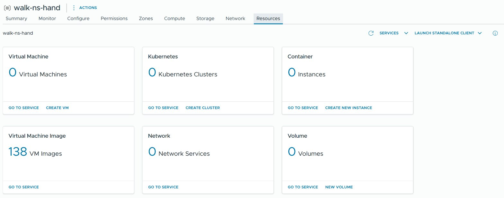

2. The **Kubernetes** card counts the namespace's clusters (*0 Kubernetes Clusters* before your
   first one) and has two links. **GO TO SERVICE** opens the list of clusters, a page titled
   **vSphere Kubernetes Service** with a **CREATE** button and the columns **Name**, **Status**,
   **Cluster Class**, **Kubernetes Release** and **Age**. Steps 5 and 6 show that list.

3. Click **CREATE CLUSTER** on the card (or **CREATE** on the list).

**Expect:** a page titled **New Kubernetes Cluster**, with `<your namespace> > Kubernetes
service > create-cluster` above the title. On its right is a pane **Kubernetes Resource YAML**:
it shows the cluster's description and changes while you fill in the page.

**If not:** no **Resources** tab — the **Local Consumption Interface** service is not installed
on this Supervisor. Its row is in the list of the Supervisor's services: your Supervisor →
**Configure** → **Supervisor Services** → **Overview**. Without it, create the cluster with
[CLUSTER-auto.md](CLUSTER-auto.md).

## 4. Fill in the create page

The page has five numbered steps. Each finished step closes to one summary line with a green
tick, and the **Kubernetes Resource YAML** pane on the right changes as you type.

1. **1. Configuration Type:** under *Create the cluster with a pre-defined default configuration
   or a custom configuration* choose **Custom Configuration**, so that you set the name and the
   storage yourself, and click **NEXT**. (With **Default Configuration** the next step is
   already **Review and Confirm**.)

   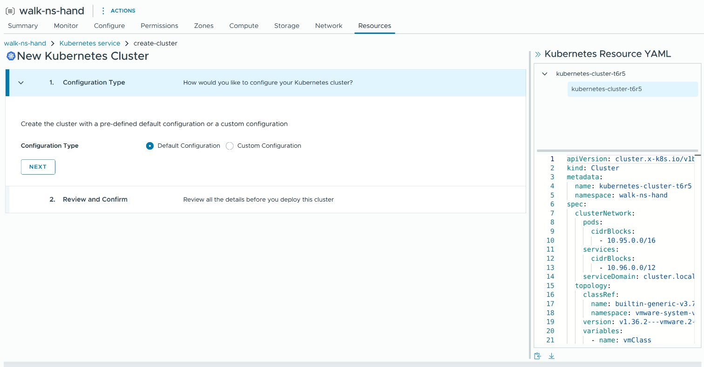

   Step 1 closes and now reads *Cluster Type: Cluster API; Configuration Type: Custom
   Configuration*.

2. **2. General Settings**, upper part:
   - **Cluster Name:** the page offers a generated name such as `kubernetes-cluster-hc39`.
     Replace it with the name you chose in step 2.
   - **Cluster Class:** choose the newest `builtin-generic-…` in the list (on the lab,
     `builtin-generic-v3.7.0`).
   - **Kubernetes Release:** choose the release (on the lab, `v1.36.2---vmware.2-vkr.3`).
   - **VM Class:** a table of the namespace's VM classes, five to a page. Select the class you
     chose in step 2 with the round button at the left of its row.
   - **Storage Class:** choose your storage class in the list (on the lab, `wcp-vmfs`). It is
     for the nodes' own disks.

   The page says above the table: *Settings configured here (VM class, Storage class, Node
   Volumes, Node Network) apply to both control plane and node pools by default. Override them
   in later steps if needed.*

   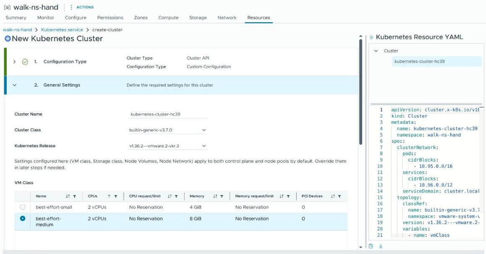

3. **2. General Settings**, lower part. Under **Storage Class** are two sections that open with
   a `>`: **Storage** (*Configure Node Volumes and Persistent Volume Storage*) and **Network**
   (*Configure Node Network and Pod Network*).

   **Open Storage and choose the default storage class: the page does not set one.** Under
   *Persistent Volume Storage* the list **Default Storage Class** is empty (*Select a storage
   class*): choose your storage class there. Without it the cluster starts and looks healthy,
   and every app that asks for a disk without naming a storage class then waits forever, its
   volume claim `Pending`. The scripted guide's cluster has this setting
   (`defaultStorageClass`). Leave the rest of **Storage** as it is: *Node Volumes* (the button
   **ATTACH VOLUME** and an empty table), **Available Storage Classes**, **Customizable Storage
   Class Annotations** and **Customizable Storage Class Labels**.

   **Network** is where the address ranges inside the cluster are changed. The YAML pane shows
   the defaults, `10.95.0.0/16` for pods and `10.96.0.0/12` for services; they must not overlap
   any network the cluster has to reach (step 2). The walk this guide was written from kept the
   defaults and did not open **Network**.

   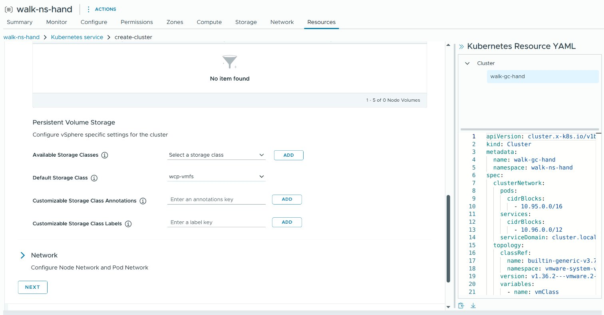

   Click **NEXT**. Step 2 closes and shows **Cluster Name**, **Cluster Class**, **Kubernetes
   Release**, **VM Class** and **Storage Class**.

4. **3. Control plane** (*Define the topology of the cluster controller*): **Replicas** is `1`;
   choose `3` for a cluster that must stay up when a node fails. **OS Image** is **Photon 5**.
   Leave the switch **Overrides** off. Click **NEXT**.

   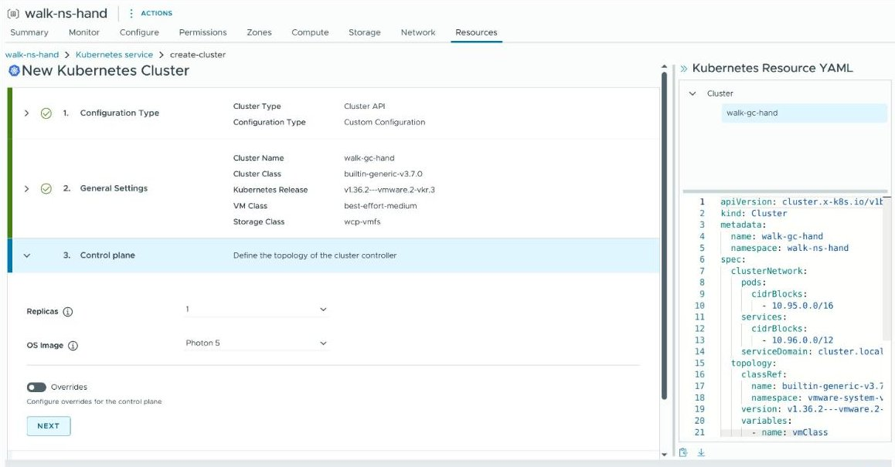

5. **4. Node pools** (*A nodepool is a group of worker nodes sharing the same resource
   allocation and storage.*): the table already holds ONE pool, named
   `<your cluster>-np-<four characters>`, with **Replicas** `1`, **OS Image** Photon 5, your VM
   class and your storage class. **So the page creates one worker node**, where the scripted
   guide creates two. One worker is enough for this guide's app. To change the number of
   workers use the row's ⋮ menu; **ADD NODEPOOL** adds a second pool. <!-- unverified -->
   Leave **Define advanced settings for this cluster** unticked. Click **NEXT**.

   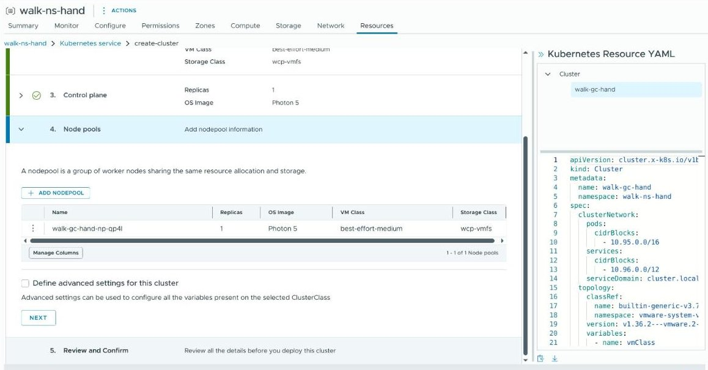

**Expect:** step **5. Review and Confirm** opens, and the four steps above it each show a green
tick and their summary line.

**If not:** a list that offers nothing — no Kubernetes release: see
[Find the Kubernetes releases](#find-the-kubernetes-releases); no VM class or no storage class:
see step 1.

## 5. Review and create

1. **5. Review and Confirm** says: *Review the configuration and the YAML file generated. Then,
   click FINISH to start deploying this cluster.* Read the **Kubernetes Resource YAML** pane
   once more: your name, the class under `classRef`, the version, and
   `defaultStorageClass` with your storage class. If `defaultStorageClass` is not in it, open
   step 2 again and choose it.

   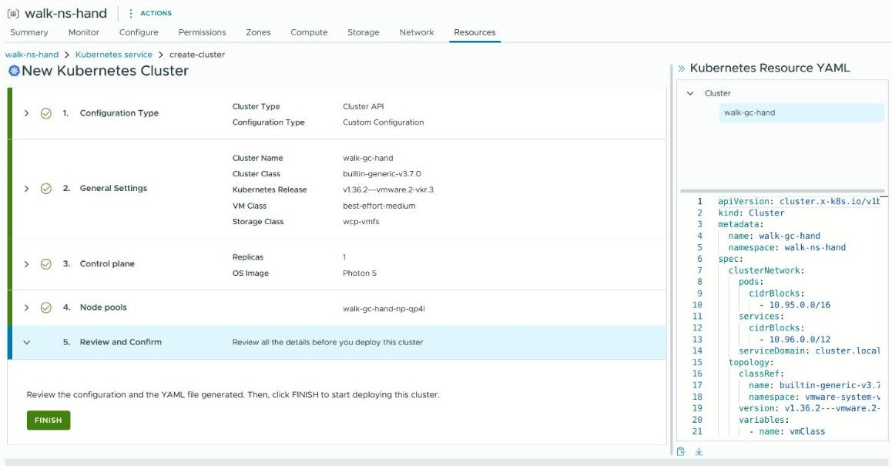

2. Click **FINISH**.

**Expect:** the client shows the list **vSphere Kubernetes Service** (`<your namespace> >
Kubernetes service` above the title), with a new row: your cluster's name, **Status** **Not
Available** with a warning sign, the cluster class, the Kubernetes release, and **Age**
`< 1 min`.

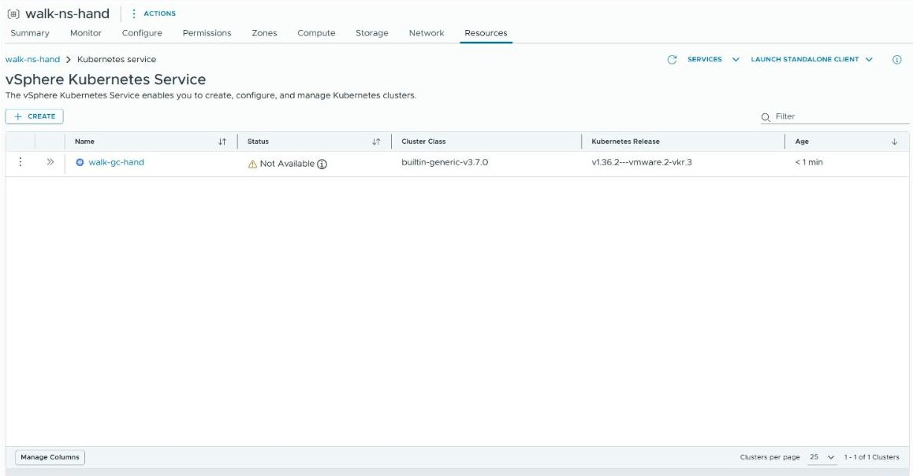

**If not:** an error naming the Kubernetes release, the cluster class, the VM class or the
storage class — that value is not one this namespace may use: go back and choose another.

## 6. Wait for the cluster

1. Watch the cluster's row. The refresh arrow at the top right of the page reloads the list.

**Expect:** **Status** shows **Not Available** while VKS builds the virtual machines, then
**Available** with a green tick; **Cluster Class** and **Kubernetes Release** show what you
chose. On a small lab a cluster of one control-plane node and one worker was **Available** after
about five and a half minutes, with the node image already downloaded. The first cluster of a
Kubernetes release takes longer: vCenter downloads that release's node image (several GB) once.

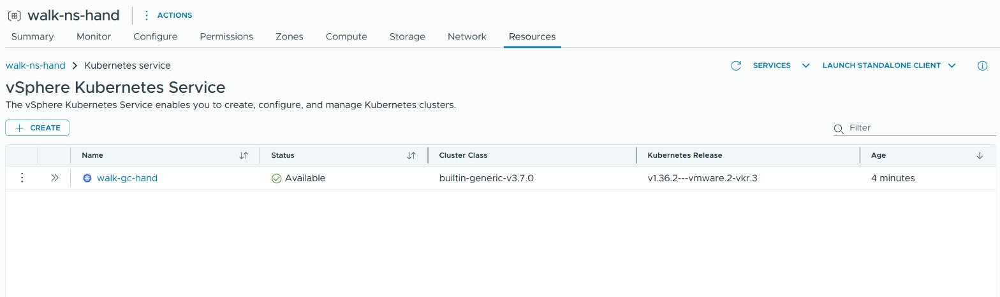

**If not:** still **Not Available** after 30 minutes — the reasons, and the commands that show
them, are under **If not** of
[Create the cluster and wait for it](CLUSTER-auto.md#create-the-cluster-and-wait-for-it).

Never switch a guest cluster's virtual machines on or off in the vSphere Client: VKS owns them
and puts them back the way it wants them.

## 7. Get the kubeconfig and check the cluster

Open the env file and set `VKS_CLUSTER` to the cluster's name.

```sh
"${EDITOR:-nano}" ~/.vks-golang-web.env
```

**Expect:** the editor opens the env file, and nothing is printed. Save and close it.

Then run the two blocks under
[Get the cluster's kubeconfig](CLUSTER.md#get-the-clusters-kubeconfig) and
[Check the cluster](CLUSTER.md#check-the-cluster): they save the cluster's kubeconfig, match
your `kubectl` to it, and check the nodes and the default storage class. On the lab the cluster
made by hand had the default storage class chosen in step 4 (`wcp-vmfs`).

**By hand, in place of the first of those two blocks:** the cluster row's ⋮ menu (step 8 has
its picture) has the entry **Download Kubeconfig File**. It saves the cluster's kubeconfig as a
file in the browser's download folder. <!-- unverified --> Move that file to the path
`GUEST_KUBECONFIG` names in your env file and make it readable only by you (`chmod 600`), then
run the block under [Check the cluster](CLUSTER.md#check-the-cluster). The download does not
match your `kubectl` to the cluster's version; the block under *Get the cluster's kubeconfig*
does.

## 8. Delete the cluster (optional)

**This destroys the cluster, its virtual machines and every disk its apps created.** Delete only
a cluster you created yourself. A cluster that ArgoCD manages comes back after you delete it
here: delete that one with the ArgoCD guide's *Delete the guest cluster* step.

1. On the **vSphere Kubernetes Service** page (**GO TO SERVICE** in step 3) find the cluster's
   row and check its name against `VKS_CLUSTER`.
2. Open the row's ⋮ menu, at the left of the row beside the `>>` that opens the row's
   details. It has three entries: **View YAML**, **Download Kubeconfig File** and **Delete**.
   Choose **Delete**.

   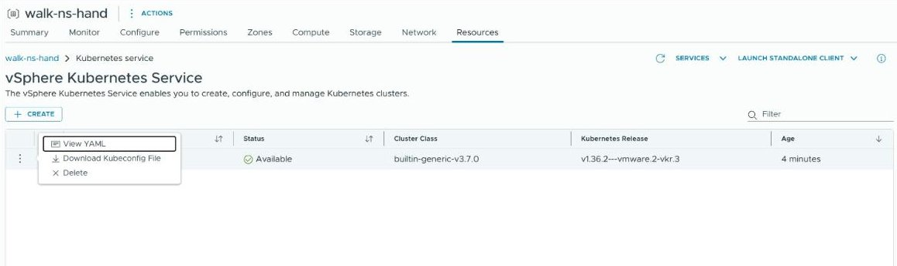

3. A window titled **Delete Kubernetes Cluster** asks *Delete Kubernetes Cluster '<name>'?*.
   Read the name, then click the red **DELETE** (**CANCEL** changes nothing).

   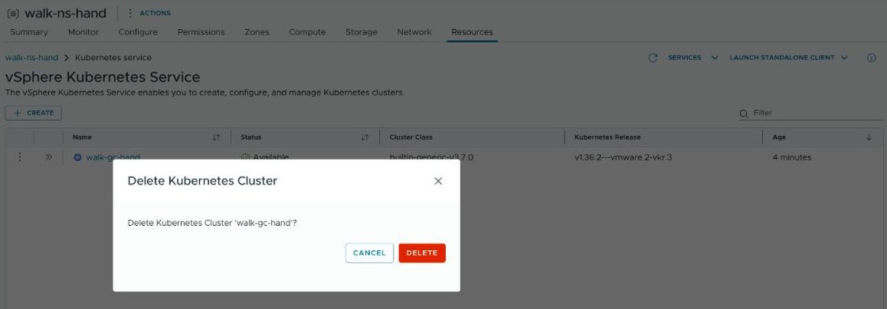

**Expect:** the row shows **Not Available** for a moment and then disappears from the list.

Do not switch the virtual machines off yourself. This checks whether the cluster and its
address are gone:

```sh
source ~/.vks-golang-web.env
echo "left (nothing after the colon means gone): $(kubectl --kubeconfig "$SUPERVISOR_KUBECONFIG" -n "$VKS_NAMESPACE" get clusters.cluster.x-k8s.io,virtualmachineservice "$VKS_CLUSTER" --ignore-not-found -o name || echo unknown)"
```

**Expect:** `left (nothing after the colon means gone):` with nothing after it: within seconds
for the small cluster on the lab, within a few minutes for a larger one. Run the block again
until then.

**If not:** a name after the colon for more than 30 minutes, or `unknown` — the cluster is still
being deleted, or the Supervisor login ended (main guide, *Renew the Supervisor login*).

Do not create the next cluster under the same name. The cluster's kubeconfig stays on this
machine until the last block of [CLEANUP.md](CLEANUP.md) deletes it.

## Fix common problems

| symptom | fix |
|---|---|
| The namespace has no **Resources** tab | The **Local Consumption Interface** service is not installed on the Supervisor (step 3). |
| The create page offers no Kubernetes release | The Supervisor's content library has no usable release: [Find the Kubernetes releases](#find-the-kubernetes-releases). |
| The cluster stays **Not Available** | The name was used before in this namespace, or the node image is still being downloaded: see **If not** under [Create the cluster and wait for it](CLUSTER-auto.md#create-the-cluster-and-wait-for-it). |
| `default storage class: NONE` in the check | **Default Storage Class** was left empty in the **Storage** section of step 4. Name the storage class in every disk request, or create a new cluster with it set. |
| `secrets "<name>-kubeconfig" not found` | `VKS_CLUSTER` is not the cluster's name, or the cluster is not **Available** yet. |

## Next

Go back to the main guide's [Deploy the app](README.md#deploy-the-app) and deploy the app onto
the new cluster.
