# Create a vSphere Namespace, by hand

This guide creates a vSphere Namespace in the vSphere Client: you look up the values it needs,
create the namespace, give other users a role in it, and add a storage policy and VM classes. It
also shows where the client keeps the values the main guide asks for. It has 9 steps; step 9 is
optional clean-up. The names are those of the vSphere Client for VMware Cloud Foundation 9.1.1,
on a Supervisor with vSphere Distributed Switch networking and the Foundation Load Balancer; an
older client says **Workload Management** where this guide says **Supervisor Management**.

The same result with command blocks in place of clicks is in
[NAMESPACE-auto.md](NAMESPACE-auto.md). If you already have a namespace, you need neither: see
[NAMESPACE.md](NAMESPACE.md).

It continues [the main guide](README.md). Only the last two steps use a terminal: run their
blocks by copy and paste, in `bash` or `zsh`, on Linux or macOS. Each is followed by
**Expect:** — what you should see — and, where it can go wrong, **If not:** — what to do. The
screenshots show example names and addresses; yours differ.

## Learn the terms

The main guide's [terms](README.md#learn-the-terms) apply. New here:

| term | meaning |
|---|---|
| vSphere Client | vCenter's web page, `https://<your vCenter>/ui` |
| storage policy | vCenter's name for a kind of disk; a namespace that has one offers it as a *storage class* |
| VM class | a virtual machine size (CPUs and memory) a namespace may use |
| role | what a user may do in a namespace: **Namespaces View**, **Namespaces Edit** or **Namespaces Owner** |

## Gather what you need

- A browser on a machine that reaches vCenter.
- A vCenter user who may create vSphere Namespaces: a vCenter administrator. Broadcom's page
  asks for the privileges *Namespaces.view*, *Namespace.edit* and *Namespaces.owner*
  ([Broadcom, VCF 9.1: create and configure a vSphere Namespace](https://techdocs.broadcom.com/us/en/vmware-cis/vcf/vcf-9-0-and-later/9-1/vsphere-supervisor-installation-and-configuration/configuring-and-managing-vsphere-namespaces/create-and-configure-a-vsphere-namespace.html)).
  If you are not one, see
  [NAMESPACE.md](NAMESPACE.md#if-you-are-not-a-vcenter-administrator).
- A Supervisor that is running (step 1 shows where to see it).
- For steps 8 and 9: the main guide's env file and its Supervisor login on this machine.

## 1. Find the Supervisor, its address and vCenter's CA

The main guide's env file asks for the Supervisor's address (`SUPERVISOR_ENDPOINT`), and its
*Download and check the vCenter CA* asks you to compare a fingerprint. Both are in the vSphere
Client.

1. Open the vSphere Client and log in. From the menu (☰, top left) choose **Supervisor
   Management**, then the **Supervisors** tab.
2. Find your Supervisor's row. **Config Status** must show **Running**. The **Control Plane Node
   Address** column holds the Supervisor's address: that is `SUPERVISOR_ENDPOINT`.

   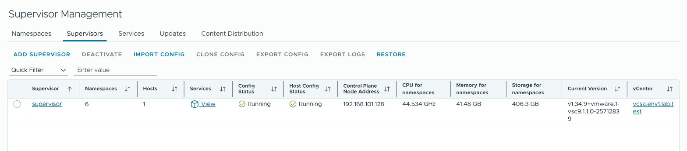

3. For vCenter's CA, open `https://<your vCenter>/` (without `/ui`) in the browser. The page has
   a grey box on the right; under **For Developers** its last link is **Download trusted root CA
   certificates**. Click it.

   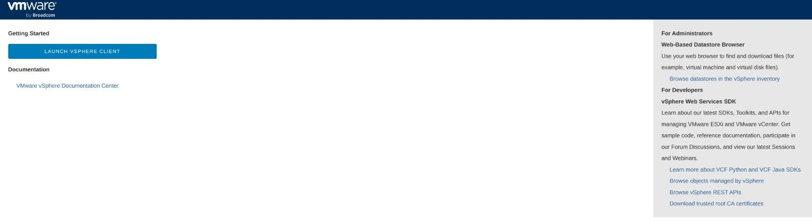

4. The browser saves `download.zip`. The CA certificate is the file ending in `.0` in its
   `certs/lin` folder (`certs/mac` on macOS). If the folder holds several `.0` files, print
   the fingerprint of each. <!-- unverified -->

**Expect:** you know the Supervisor's address, and you have vCenter's CA certificate from
vCenter's own page. The main guide's
[Download and check the vCenter CA](README.md#download-and-check-the-vcenter-ca) prints a
fingerprint: it must equal the fingerprint of this file (`openssl x509 -in <the file> -noout
-fingerprint -sha256` prints it).

**If not:** **Config Status** shows anything but **Running** — the Supervisor is not ready; a
namespace cannot be created on it yet. No Supervisor in the list — this vCenter has none.

## 2. Find the storage policies and the VM classes

A namespace needs one storage policy and at least one VM class. Look at what vCenter has before
you create the namespace.

1. From the menu (☰) choose **Policies and Profiles**. **VM Storage Policies** is the first
   entry of the list on the left.

   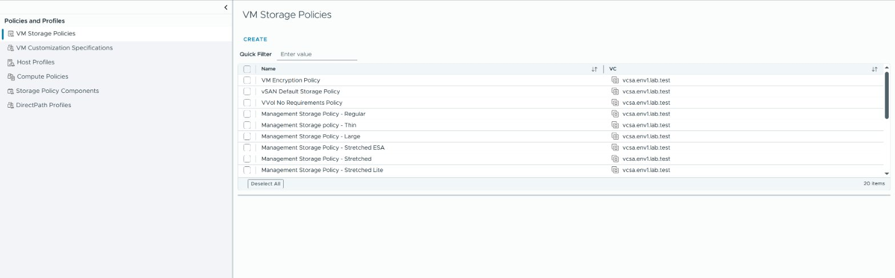

2. Note the name of one policy. You do not have to know its free space yet: the window in
   step 5 shows it beside each policy. A policy with **Encryption** in its name needs a key
   provider; do not choose one unless you know the vCenter has it.
3. From the menu (☰) choose **Supervisor Management**, then the **Services** tab. On the **VM
   Service** card click **MANAGE**. The **VM Service** page has three buttons, **Overview**,
   **VM Classes** and **Content Libraries**: click **VM Classes**.

   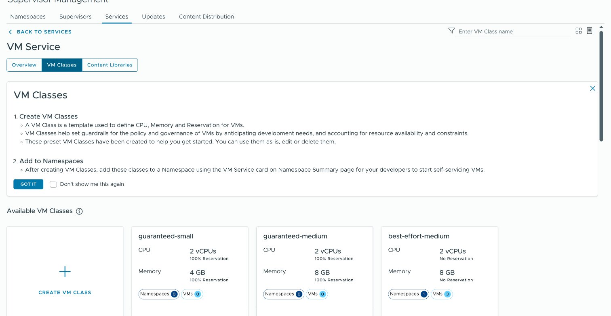

4. Note the classes the cluster may use. Each card shows the class's name, its CPUs and its
   memory. A class with 2 CPUs and 4 GB (`best-effort-small`) is enough for this app; add one
   with 8 GB (`best-effort-medium`) if you plan to add Istio later
   ([Choose the cluster's values](CLUSTER-auto.md#choose-the-clusters-values) has the sizes).

**Expect:** one storage policy name and one or two VM class names.

**If not:** no **VM Service** card — the Supervisor's VM Service is not there; a guest cluster
cannot be built without it.

## 3. Create the namespace

1. From the menu (☰) choose **Supervisor Management**. On the **Namespaces** tab click **NEW
   NAMESPACE**, above the list.

   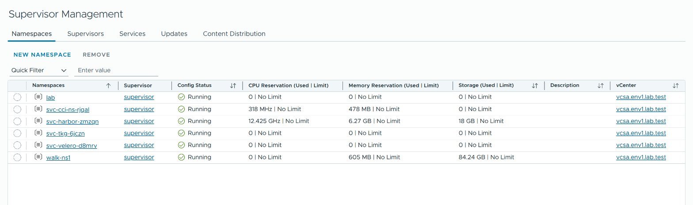

   A window titled **Create Namespace** opens. It has four steps.

2. **1 Location:** under *Select a Supervisor where you would like to create this namespace*
   the window shows your vCenter's name with the Supervisor under it. Click the Supervisor,
   then **NEXT**.
3. **2 Configuration:**
   - **Name:** lower-case letters, digits and `-`, and a name no namespace has yet. The window
     says it under the field: *Name of namespace cannot be changed once it is created.*
   - **Default Network:** leave the network that is already chosen (on the lab,
     `workloadnetwork0`).
   - **Additional Networks:** leave it at *-- Select Network --*.
   - **Description:** type who made the namespace and why, for example
     `Made by <your name> for the golang-web guest cluster`. Step 9 reads it before you delete
     anything.

   Click **NEXT**.

   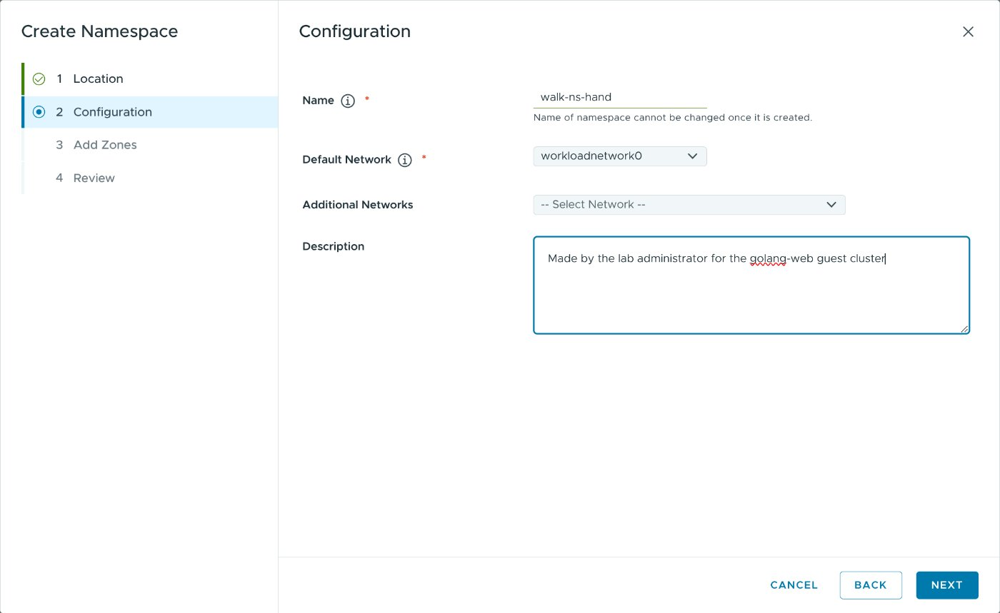

4. **3 Add Zones:** under *Select zones to add to the namespace for workload compute* the table
   **Workload Zone** lists the Supervisor's zones, with one already ticked. Leave it as it is
   and click **NEXT**.
5. **4 Review:** check **Name**, **Supervisor**, **Default Network**, **Additional Networks**
   and **Zones**, then click **FINISH**.

**Expect:** the client opens the new namespace's **Summary** page, with a panel *Your namespace
<name> has been successfully created.* and a **GOT IT** button. Under it are these cards:

| card | on a new namespace |
|---|---|
| **Status** | the date it was created, **Config Status** **Running**, **Kubernetes Status** **Active** |
| **Storage** | *You haven't added any storage policies for this namespace…* and the button **ADD STORAGE** |
| **Capacity and Usage** | **CPU Reservation**, **Memory Reservation** and **Storage**, each *No limit*; the link **EDIT LIMITS** |
| **Kubernetes Service** | 0 Kubernetes clusters, 1 Associated Content Libraries |
| **VM Service** | 0 Associated VM Classes with the link **ADD VM CLASS**; 0 Associated Content Libraries with the link **ADD CONTENT LIBRARY** |
| **Pods**, **Zones** | not used by these guides; **Zones** counts the zone from step 3 |

The row of tabs above them reads **Summary**, **Monitor**, **Configure**, **Permissions**,
**Zones**, **Compute**, **Storage**, **Network**, **Resources**.

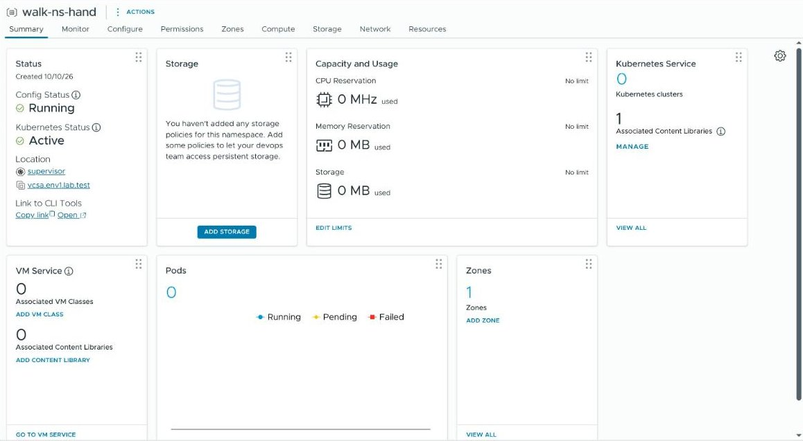

**If not:** **NEW NAMESPACE** is greyed out or missing — your user may not create namespaces, or
no Supervisor is running (step 1). An error about the name — a namespace of that name exists, or
the name has a character that is not allowed. On a Supervisor with NSX the **Configuration**
step asks for more network values: take what your network administrator names.

## 4. Give your user a role

**As a vCenter administrator you add nothing for yourself.** Your user is already in the
namespace's list: open the **Permissions** tab and you see it (on the lab,
`VSPHERE.LOCAL\Administrator` with the role **Supervisor Administrator**, defined in the
Supervisor). Do this step only to let ANOTHER user work in the namespace. There is no
permissions card on the **Summary** page.

1. Open the namespace's **Permissions** tab. Above the list, which has the columns
   **User/Group**, **Role** and **Defined In**, are the buttons **ADD**, **EDIT** and
   **DELETE**. Click **ADD**.
2. In the **Add Permission** window choose the **Domain** (`vsphere.local` for a user made in
   vCenter itself) and type the user's name in **User/Group**.
3. Choose the **Role**. The list starts at **Administrator**: change it. It holds all vCenter
   roles; the three for a namespace are **Namespaces View**, **Namespaces Edit** and
   **Namespaces Owner**. **Namespaces Edit** is the *Edit role* these guides name.
4. Leave **Propagate to children** ticked and click **OK**.

   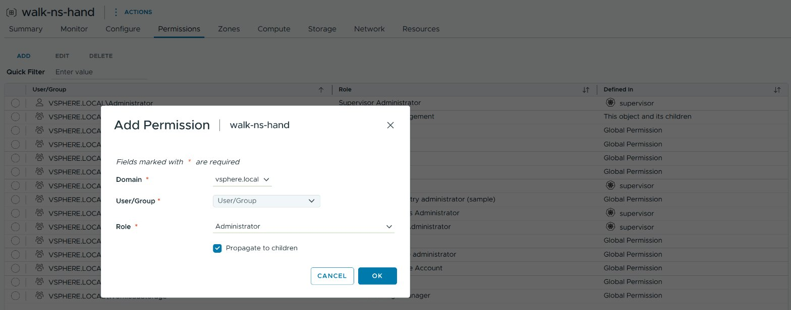

**Expect:** the list on the **Permissions** tab has a new row with the user and the role.

**If not:** the user is not found — the **Domain** is not the one the user is in.

## 5. Add a storage policy

1. On the **Summary** page, in the **Storage** card, click **ADD STORAGE**.
2. The **Select Storage Policies** window lists each policy with its **Total Capacity** and its
   **Available Capacity**. Tick one with room for the cluster's disks, about 150 GB for this
   guide's cluster and its apps, and click **OK**.

   

**Expect:** the **Storage** card shows *Storage Policies 1* and the policy's name with *No
limit*, and its link now reads **EDIT STORAGE**. The namespace now offers a storage class named
after the policy, and a second one with `-latebinding` at its end (on the lab: `wcp-vmfs` and
`wcp-vmfs-latebinding`).

## 6. Add the VM classes

1. In the **VM Service** card click **ADD VM CLASS**.
2. The **Add VM Class** window lists the classes with each one's **CPU**, **Memory** and
   their reservations, ten to a page: with more than ten classes, look on the next page too. Tick
   the classes you chose in step 2 (`best-effort-small` and `best-effort-medium`) and click
   **OK**.

   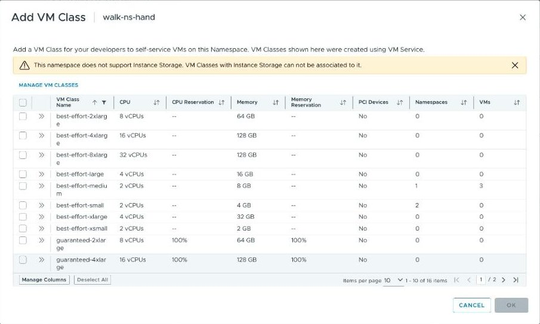

   The yellow line about *Instance Storage* is a note, not an error.

**Expect:** the **VM Service** card shows *2 Associated VM Classes* (the number you ticked), and
its link now reads **MANAGE VM CLASSES**.

Do not click **ADD CONTENT LIBRARY**: a guest cluster needs no content library in the
namespace. Its Kubernetes releases come from the Supervisor's own library, which the
**Kubernetes Service** card already counts (*1 Associated Content Libraries*).

## 7. Set limits and check the status

1. Leave the **Capacity and Usage** card at *No limit*. If your company wants limits, click
   **EDIT LIMITS** and leave room for one control-plane node and two or three worker nodes: at
   least 8 CPUs, 24 GB of memory and 150 GB of storage.
2. Look at the cards once more.

   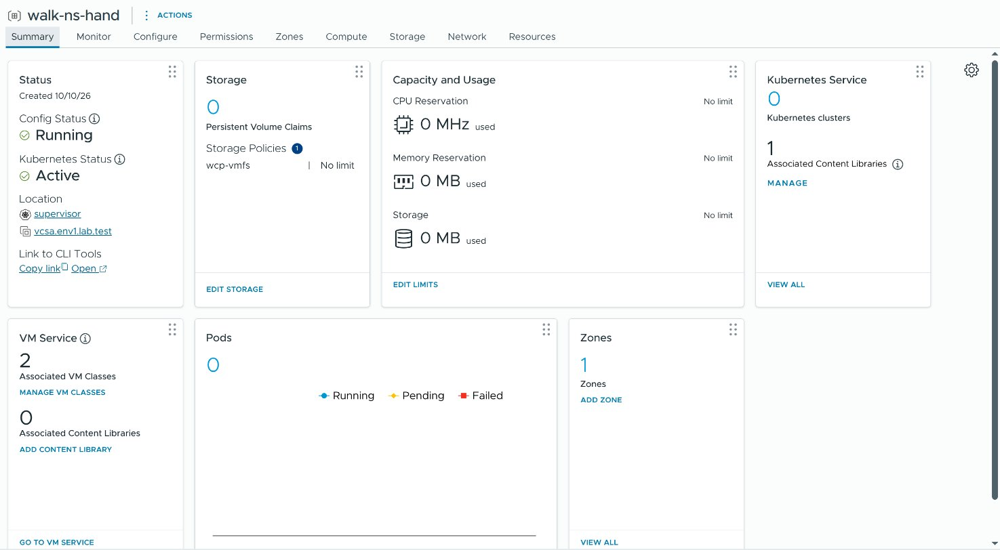

**Expect:** **Config Status** **Running** and **Kubernetes Status** **Active** in the
**Status** card, the policy's name in **Storage**, and *2 Associated VM Classes* in **VM
Service**.

**If not:** a status other than **Running** after some minutes — the card's message says why.

## 8. Set the name and check the namespace

Open the env file and set `VKS_NAMESPACE` to the namespace's name.

```sh
"${EDITOR:-nano}" ~/.vks-golang-web.env
```

**Expect:** the editor opens the env file, and nothing is printed. Save and close it.

If you were logged in to the Supervisor before the namespace existed, or before the user got
its role, run the main guide's
[Delete the Supervisor login](README.md#delete-the-supervisor-login) block and
[log in again](README.md#log-in-to-the-supervisor), so that the login is made with the
namespace and the role in place.

Then run both blocks of
[Check the namespace you have](NAMESPACE.md#check-the-namespace-you-have). They prove that the
namespace can hold a guest cluster: its VM classes, its storage class, the Kubernetes releases
and the cluster classes.

## 9. Remove the namespace (optional)

**Deleting a vSphere Namespace destroys everything in it**: every guest cluster with its
virtual machines and disks, every ArgoCD instance, every secret, with no way back. Delete only
a namespace you created yourself, and only when it holds nothing you want to keep.

First list what is left in it:

```sh
source ~/.vks-golang-web.env
kubectl --kubeconfig "$SUPERVISOR_KUBECONFIG" -n "$VKS_NAMESPACE" get clusters.cluster.x-k8s.io
```

**Expect:** `No resources found in <your namespace> namespace.`

**If not:** a cluster is listed — delete it first, the way it was made
([with scripts](CLUSTER-auto.md#delete-the-cluster) or
[by hand](CLUSTER-manual.md#8-delete-the-cluster-optional)). `Forbidden` or `NotFound` — check
`VKS_NAMESPACE`: you are about to delete a namespace you cannot read.

Then, in the vSphere Client:

1. From the menu (☰) choose **Supervisor Management**, then the **Namespaces** tab.
2. Find the namespace's row and read its **Description** column: it must be the text you typed
   in step 3. If it is not, or the column is empty, this is not the namespace you created: stop.
3. Select the row with the round button at its left (the row is then highlighted) and click
   **REMOVE**, above the list.

   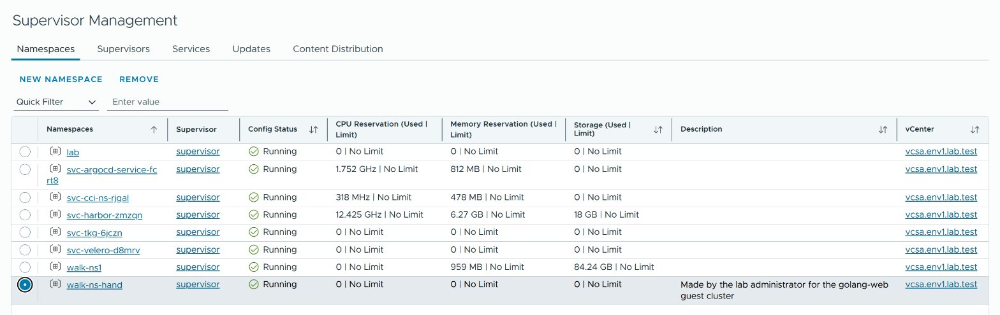

4. A window titled **Delete | <your namespace>** opens with a warning: *Before you remove a
   vSphere Namespace, you should delete any VKS clusters, vSphere Pods, VMs provisioned there.
   Do not attempt to delete a VKS cluster using the vSphere Client or the vCenter Server CLI.*
   The guides delete a guest cluster on the namespace's **Kubernetes service** page or with
   `kubectl`, never by removing its virtual machines. Read the namespace's name in the title,
   then click the red **DELETE** (**CANCEL** changes nothing).

   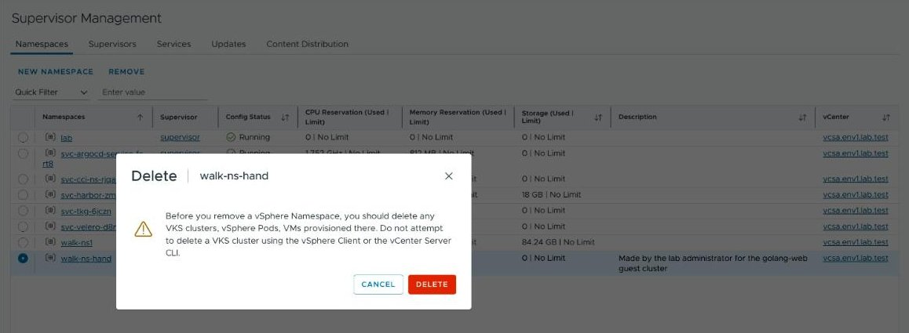

**Expect:** the row's **Config Status** shows **Removing**, and the row then disappears from the
list.

**If not:** the row stays in **Removing** for more than 15 minutes — something in the namespace
does not end. Do not create a namespace of the same name meanwhile.

The scripted guide's delete blocks refuse a namespace made by hand, because it does not carry
their marker: that is intended.

## Fix common problems

| symptom | fix |
|---|---|
| **NEW NAMESPACE** is missing or greyed out | Your user may not create namespaces, or the Supervisor is not **Running** (step 1). |
| `kubectl get ns` answers `Forbidden` for the new namespace | The SSO user you logged in with is not on the namespace's **Permissions** tab (step 4), or the role was given after you logged in: delete the Supervisor login and log in again (step 8). |
| The check prints nothing under `VM classes:` | No VM class is assigned (step 6). |
| The check prints nothing under `Storage classes:` | No storage policy is assigned (step 5). |
| A cluster is refused with a message about the VM class or the storage class | The namespace does not have that class: add it (steps 5 and 6). |

## Next

Go on with [Use or create a guest cluster](CLUSTER.md).
